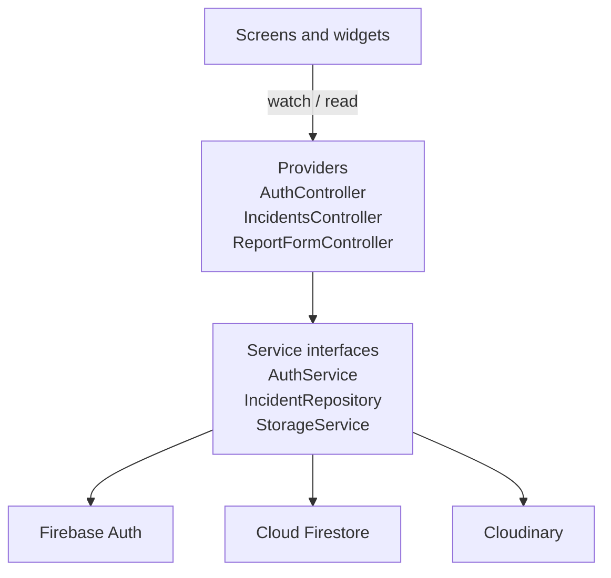

# Campus Incident Reporter

A Flutter mobile app that lets students report campus problems (broken facilities, water shortages, power outages, damaged furniture, sanitation and safety issues) and lets campus staff review those reports and move them through to resolution.

Built with Flutter, Provider, Firebase Authentication, Cloud Firestore and Cloudinary for photo storage.

## Features

**Students**
- Create an account and sign in with email and password, with password reset
- Report an incident with a category, title, description, campus location and an optional photo (camera or gallery)
- Browse their own reports or everything reported on campus
- Search by keyword and filter by status and category
- Follow a report's progress on a live status timeline and read staff notes
- Withdraw a report before staff pick it up
- See status changes in an updates feed

**Staff**
- Campus-wide dashboard with counts per status
- Review queue of newly submitted reports
- Move reports between Submitted, In Progress and Resolved, with an optional note for the student
- Remove duplicate or invalid reports

## Architecture

```
lib/
├── main.dart                 Firebase initialisation
├── app.dart                  Provider wiring and MaterialApp
├── routes.dart               Named routes
├── core/
│   ├── constants/            Campus locations
│   ├── theme/                Colours, theme, status styles
│   └── utils/                Validators, date formatting, filtering
├── models/                   Incident, StatusUpdate, AppUser, enums
├── services/                 Firebase-backed data access behind interfaces
├── providers/                ChangeNotifier controllers (app state)
├── screens/                  One folder per feature
└── widgets/                  Reusable UI components
```

The app follows a layered structure:



- **Screens** only render state and forward user actions.
- **Providers** hold app-wide state (current session, report lists, filters, form progress) and expose it through `ChangeNotifier`.
- **Services** are abstract classes with Firebase implementations, so controllers can be unit tested with in-memory fakes.

`IncidentsController` is a `ChangeNotifierProxyProvider` of `AuthController`: whenever the signed-in user changes it re-subscribes to the right Firestore streams, so sign-out cleanly drops all data.

## Firestore data model

```
users/{uid}
  name: string
  email: string
  role: "student" | "staff"
  department: string
  campus: string
  createdAt: timestamp

incidents/{incidentId}
  title: string
  description: string
  category: "facilities" | "water" | "electricity" | "safety" | "sanitation" | "furniture"
  status: "submitted" | "in_progress" | "resolved"
  location: string
  reporterId: string        -> users/{uid}
  reporterName: string
  imageUrl: string | null
  imagePath: string | null  -> Cloudinary public_id
  staffNote: string | null
  createdAt: timestamp
  updatedAt: timestamp
  timeline: [ { status, at, byName, note? } ]
```

Photos are uploaded to Cloudinary under `campus-incidents/{uid}/{incidentId}` and the returned HTTPS URL is saved on the incident.

### Why Cloudinary instead of Firebase Storage
New Firebase projects can only create a Storage bucket on the paid Blaze plan, which requires a billing account. Cloudinary's free tier needs no card, serves images over a global CDN and supports uploads straight from the app through an *unsigned upload preset*, so no API secret is shipped in the APK. The upload code sits behind the `StorageService` interface, so switching back to Firebase Storage only means adding a new implementation.

## Access control

Roles are enforced on the server by the rules in [`firebase/`](firebase), not just hidden in the UI:

- Self-registration can only create a `student` user document, and users can never change their own role.
- Any signed-in user can read incidents; a report can only be created by its reporter with status `submitted`.
- Only users whose profile has `role: "staff"` can update an incident, and only the `status`, `updatedAt`, `timeline` and `staffNote` fields. Every update must append exactly one timeline entry.
- Students can delete their own report only while it is still `submitted`.
- Photo uploads use an unsigned Cloudinary preset with overwriting disabled. The app never holds a Cloudinary API secret, so it cannot delete or replace existing images. Photos are compressed on the device (max 1600 px, 70% JPEG quality) before upload.

## Getting started

### Prerequisites
- Flutter 3.35 or newer (stable channel) and an Android emulator or physical device
- A Firebase project (free Spark plan is enough)
- A free Cloudinary account

### 1. Firebase
1. In the Firebase console create a project, then add an **Android app** with package name `com.campusreporter.campus_incident_reporter`.
2. Enable **Authentication → Email/Password** and create a **Firestore Database**.
3. Copy the values from *Project settings → Your apps* into `lib/firebase_options.dart`. (Alternatively run `flutterfire configure`, which needs the Firebase CLI.)
4. Paste `firebase/firestore.rules` into *Firestore → Rules* and publish. Create the composite index from `firebase/firestore.indexes.json` (`reporterId` ascending, `createdAt` descending), or follow the link Firestore logs the first time the query runs.

### 2. Cloudinary
1. In the Cloudinary console go to *Settings → Upload → Upload presets* and add a preset named `campus_incidents` with **Signing mode: Unsigned** (overwrite is off by default for unsigned presets).
2. Put your cloud name in `lib/config/cloudinary_config.dart`.

### 3. Run
```bash
flutter pub get
flutter run
```

### Creating a staff account
1. Register a normal account in the app.
2. In the Firestore console open `users/{that uid}` and change `role` to `staff`.
3. Sign out and back in. The staff dashboard and status controls will appear.

## Testing

```bash
flutter test
```

- **Unit tests** cover validators, date formatting, model serialisation, search and filtering, and both controllers (role checks, scope switching, status updates, report submission) using fake services.
- **Widget tests** cover the login form validation and error handling, and the status chip.
- Security rules were checked manually against the scenarios listed under Access control.

## Tech stack

| Concern | Choice |
|---|---|
| UI | Flutter, Material 3 |
| State management | Provider (`ChangeNotifier`, `ChangeNotifierProxyProvider`) |
| Authentication | Firebase Authentication (email and password) |
| Database | Cloud Firestore with real-time listeners |
| Photo storage | Cloudinary (unsigned uploads over HTTPS) |
| Images | image_picker with client-side compression |
